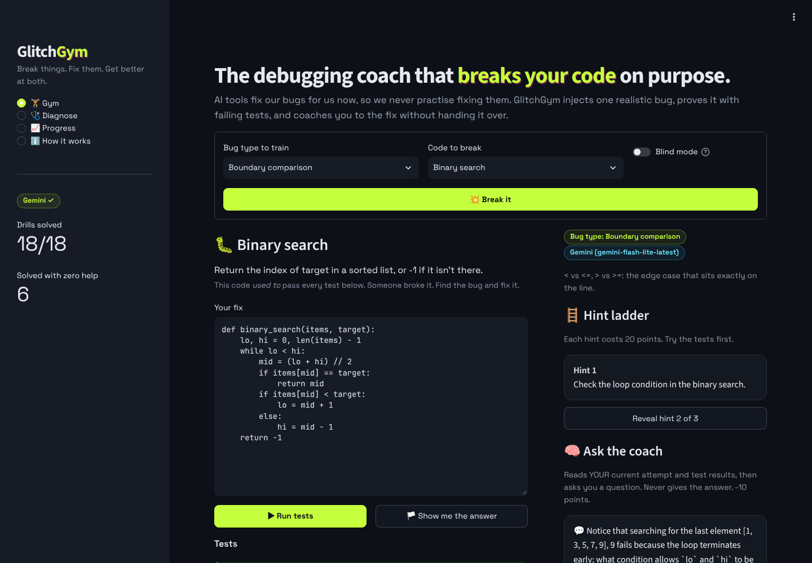
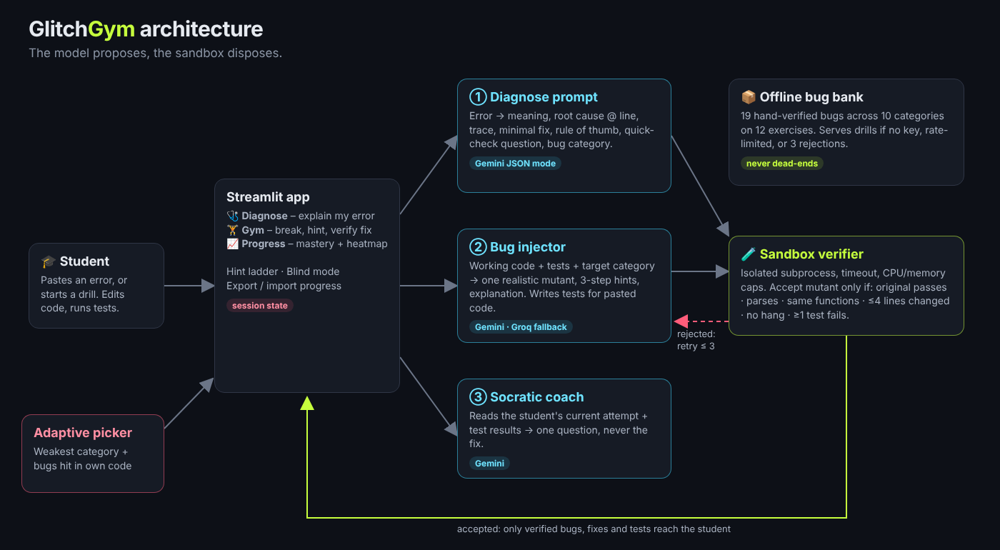

# 🏋️ GlitchGym

**The debugging coach that breaks your code on purpose — so you learn to fix anyone's.**

Built for **GLITCHATHON 2026** (theme: *Build with AI*) · Track: **2. Glitch Detective**

AI assistants now fix students' bugs for them. The error disappears, and so does the learning. GlitchGym flips it:

1. **🩺 Diagnose** — paste broken code (and optionally the error). GlitchGym runs it, then explains *why* it broke: plain-English meaning, root cause at the exact line, a step-by-step trace, a minimal fix that is **executed in a sandbox before you see it**, a rule of thumb, and a quick-check question. Then one click sends you to a drill on the same bug type.
2. **🏋️ Gym** — GlitchGym takes code that *works*, asks the AI to inject **one realistic bug** of a chosen type, and only accepts the bug once the sandbox **proves** it: the original passes every test, the mutant fails at least one. You fix it in the browser, with a 3-step hint ladder and a Socratic coach that reads *your* attempt and asks a question instead of giving the answer.
3. **📈 Progress** — mastery per bug type, a drill-history heatmap, and the bugs you hit in your own code. The next drill always targets your weakest area.



## How AI is used

| Where | Model | What it does | How it's kept honest |
|---|---|---|---|
| Diagnose | Gemini (JSON mode, T=0.2) | Error → meaning, root cause, trace, fix, rule of thumb, quiz, bug category | Suggested fix is run in the sandbox; result shown as ✅ / ⚠️ |
| Bug injector | Gemini (T=0.8), Groq Llama 3.3 70B fallback | Working code + tests + target category → one mutant, 3 hints, explanation | Verifier: parses · same functions · ≤4 lines changed · no hang · ≥1 failing test. Rejections go back to the model with the reason (≤3 tries) |
| Test writer | Gemini (T=0.2) | Writes tests for code the student pastes | Only tests the student's working code actually passes are kept |
| Socratic coach | Gemini (T=0.5) | Reads the current attempt + test results, returns one nudge | Prompted never to reveal the fix; falls back to static hints |

**The model proposes, the sandbox disposes.** If there's no API key, the API is rate-limited, or the model fails verification three times, a hand-verified **offline bug bank** (19 bugs, 10 categories, 12 exercises) keeps the gym running.



## Bug categories

Off-by-one · Boundary comparison · Mutable default argument · Aliasing · Missing/misplaced return · Type mix-up · Scope & reset · Mutating while iterating · Boolean & branch logic · Dictionary updates

## Run it locally

```bash
git clone https://github.com/ShermaineYap/glitchgym.git
cd glitchgym
python -m venv .venv && source .venv/bin/activate   # Windows: .venv\Scripts\activate
pip install -r requirements.txt
cp .env.example .env        # then paste your free key from https://aistudio.google.com/apikey
streamlit run app.py
```

Open http://localhost:8501. Without a key the app runs in **offline mode** (bug bank + rule-based diagnosis), so it never breaks during a demo.

Run the tests (LLM is mocked, so they work offline):

```bash
pip install pytest
pytest -q        # 48 tests
```

## Deploy (Streamlit Community Cloud, free)

1. Push this repo to GitHub (public).
2. Go to https://share.streamlit.io → **Create app** → pick the repo, branch `main`, file `app.py`.
3. **Advanced settings → Secrets**, paste:
   ```toml
   GEMINI_API_KEY = "your-key"
   # GROQ_API_KEY = "optional-fallback-key"
   ```
4. Deploy. The sidebar shows **Gemini ✓** when the key is picked up.

## Project structure

```
app.py                  Streamlit UI (Gym, Diagnose, Progress, How it works)
glitchgym/
  sandbox.py            isolated subprocess runner, per-test results, timeouts, CPU/memory caps
  coach.py              diagnose / bug-injection / verifier / Socratic coach prompts and logic
  llm.py                Gemini REST client with model fallback, Groq fallback, JSON parsing
  catalog.py            bug categories, 12 seed exercises, 19-bug offline bank
  progress.py           attempt log, mastery, adaptive next-drill picker
tests/test_glitchgym.py 48 tests: sandbox, every seed bug, verifier, retry loop (mocked LLM), adaptivity
docs/                   architecture diagram, screenshots
```

## Limitations

- Python only. The sandbox is a separate isolated process with a timeout and resource limits — fine for a demo, but not a hardened security boundary for hostile code on a shared server (a production version would use containers or WebAssembly Pyodide in the browser).
- Progress lives in the browser session; export/import JSON to keep it. No accounts.
- Free-tier API rate limits apply; the offline bank covers gaps.

## Future improvements

- Run code in the browser with Pyodide (zero server execution).
- JavaScript and Java support.
- Instructor mode: upload a lab's starter code and get a set of verified bug drills for the class.
- Spaced repetition for weak bug types; streaks and class leaderboards.
- VS Code extension: "train this bug type" straight from a real traceback.

## Built with

Python · Streamlit · Google Gemini API (Google AI Studio) · Groq (Llama 3.3 70B) · pandas · Plotly · pytest · Playwright (screenshots)

## AI-assistance disclosure

As the rules ask: GlitchGym was built during the hackathon with help from an AI coding assistant (Claude) for scaffolding, code and documentation, which I reviewed, tested and ran. At runtime the app uses Gemini (and optionally Groq) as described above.
